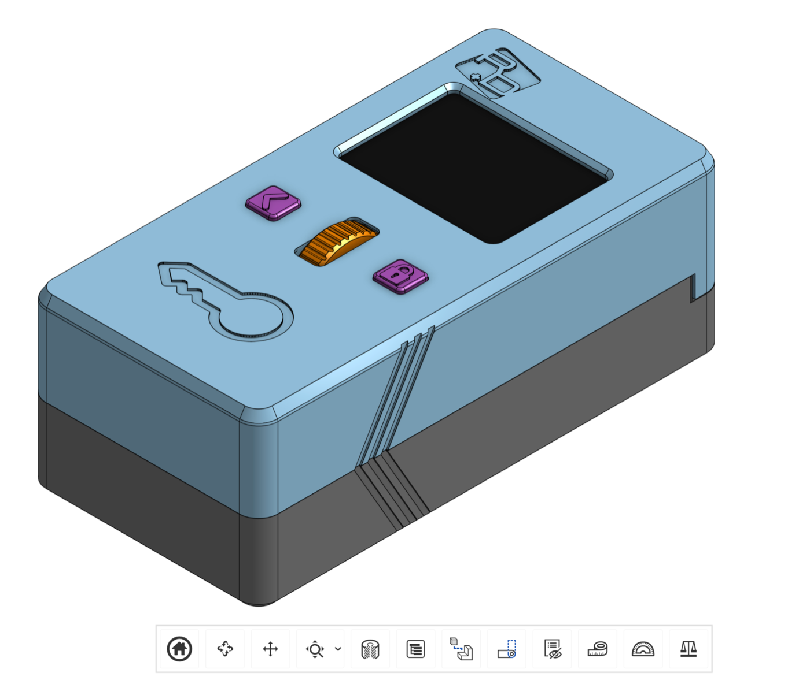

## Purpose

These docs collect the Lockbox hardware assembly information in a self-contained folder for future aggregation into `ohai.researchanddesire.com`. They are written as open hardware assembly instructions for OSS builders and manufacturing collaborators.

## Safety first

The Lockbox contains a 3.7 V lithium polymer (LiPo) battery. The build uses
superglue, a hot glue gun, isopropyl alcohol, small neodymium magnets, and
soldering. Read the safety notes at each step of the
[assembly guide](/lockbox/assembly-guide).

- If a battery swells, leaks, gets hot, or smells, stop charging or using it
  and move it to a non-flammable surface, away from anything that can burn. Do
  not use it again.
- Keep loose magnets away from children and pets. Swallowed magnets can cause
  serious internal injury.
- Before a finished Lockbox holds a key, read
  [Safety & Emergency Access](https://docs.researchanddesire.com/lockbox/safety)
  and both emergency options: the
  [software emergency unlock](https://docs.researchanddesire.com/lockbox/using/emergency-unlock)
  and the destructive
  [hardware emergency unlock (break the backplate)](https://docs.researchanddesire.com/lockbox/support/emergency-backplate).

## Lockbox overview

Lockbox is a small-scale consumer electronics product built around a custom PCB, ESP32-S3 firmware, a motorized latch, magnetic sensors, TFT display, rotary encoder, battery, and 3D-printed plastic housing.

| Property | Value |
| -------- | ----- |
| Dimensions | 57 mm x 43 mm x 134 mm |
| Plastic volume | 156,408.422 mm^3 |
| Current housing material | 3D-printed PLA plastic |
| Embedded magnets | Three to four magnets in the plastic housing |

## Assembly package

- [PCB Overview](/lockbox/pcb-overview)
- [Bill of Materials](/lockbox/bom)
- [Assembly Guide](/lockbox/assembly-guide)
